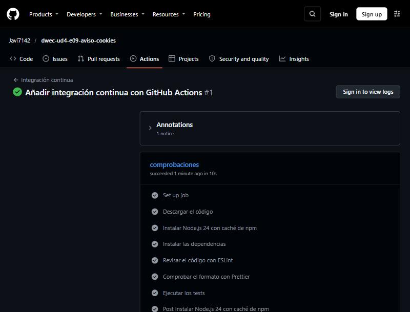
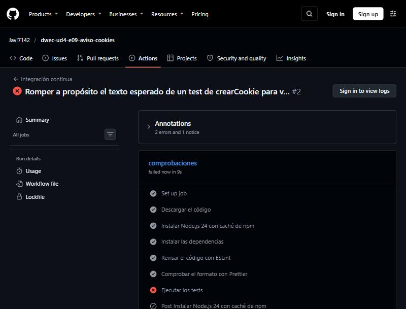

# Aviso de cookies y preferencias

Repositorio del ejercicio: <https://github.com/Javi7142/dwec-ud4-e09-aviso-cookies>

## Cómo ejecutarlo

**La página.** Abro en VS Code la carpeta del ejercicio (`E09-AvisoCookies`, la que contiene `.devcontainer/`) y ejecuto **Dev Containers: Reopen in Container**. Al conectarse, el contenedor instala las dependencias, arranca el servidor (`npx serve@14.2.6 --listen 3409 .`) y reenvía el puerto 3409: la página se ve en <http://localhost:3409/>. Al ser una página web, no hay `npm start`.

**Tests, ESLint y Prettier**, en la terminal del contenedor:

```bash
npm test               # tests con Vitest
npm run lint           # ESLint
npm run format:check   # comprueba el formato con Prettier (npm run format lo corrige)
```

## Qué se guarda y dónde

| Dato | Mecanismo | Clave o nombre | Duración | Por qué ese mecanismo |
|------|-----------|----------------|----------|-----------------------|
| La decisión sobre las cookies: `{ version, analitica, personalizacion, fecha }` | `localStorage` | `consentimiento` | Hasta que el programa la da por caducada (12 meses desde `fecha`); el navegador no la borra solo | Es un dato que solo necesita la página: se guarda en el navegador, sin viajar al servidor en cada petición, y es persistente. Cabe un JSON con la fecha, que es lo que permite calcular la caducidad |
| El nivel de consentimiento (`analitica` o `tecnicas`) | Cookie | `consentimiento` | 1 año (`max-age=31536000`), `path=/`, `SameSite=Lax` y `Secure` si la página va por HTTPS | Es lo único que se escribe como cookie porque es lo que **el servidor** puede necesitar en cada petición (por ejemplo, para no incluir la analítica en la respuesta). Las cookies viajan solas con cada petición; `localStorage` no |
| El tema elegido: `{ tema }` | `localStorage` | `preferencias` | Sin caducidad (hasta que el usuario cambie de tema o borre los datos del sitio) | Es una preferencia de presentación que solo usa el cliente; no hace falta enviarla al servidor, así que una cookie sería peor (viajaría en cada petición) |
| Haber aplazado la decisión | `sessionStorage` | `aviso-aplazado` (valor `si`) | Hasta que se cierra la pestaña | Aplazar no es una decisión: solo debe valer para **esta pestaña**, de modo que al volver otro día se pregunte de nuevo. `sessionStorage` se borra solo al cerrar la pestaña |

## Privacidad

**1. Qué es técnico y qué necesita consentimiento.** Según mi lectura del RGPD, la LSSI (art. 22.2) y la guía de cookies de la AEPD:

- **Técnicos (no necesitan consentimiento, solo informar):** el tema (lo pide el usuario expresamente con un botón: es una preferencia de interfaz), la cookie `consentimiento` y la clave `consentimiento` de `localStorage` (son necesarias para **recordar la propia decisión** del usuario sobre las cookies) y `aviso-aplazado` (solo recuerda, durante la sesión, que se ha cerrado el aviso).
- **Necesitan consentimiento previo:** la **analítica** (medir las visitas no es imprescindible para prestar el servicio que pide el usuario) y la **personalización** (recomendaciones basadas en el comportamiento). Por eso ninguna se activa si no hay un consentimiento que las acepte.

**2. Que la analítica no se activa antes de aceptarla.** Hay un solo sitio donde se activa (`activarAnaliticaSiHaySiAcepto` en `main.js`) y solo lo hace si `consentimientoActual()?.analitica === true`, es decir, si hay un consentimiento **vigente** que la acepta. Al cargar la página sin ninguna decisión, el aviso se abre y no se muestra nada en la consola; la analítica (simulada con `console.log`) solo aparece después de pulsar **Aceptar todas** o de **Guardar selección** con la casilla de analítica marcada, y una sola vez por carga de página. Lo comprobé con la consola: con la decisión rechazada, con el consentimiento caducado (aunque en el registro viejo la analítica estuviera a `true`), con el JSON roto, con otra versión y con el aviso aplazado, no sale ningún mensaje de analítica.

**3. Por qué caduca y qué pasa al caducar.** Un consentimiento no vale para siempre: puede que el usuario haya cambiado de opinión, que la web use las cookies de otra forma o que se hayan añadido categorías. Por eso el registro lleva su `fecha` y una `version`: pasados `CADUCIDAD_MESES` (12) o si cambia la versión, `consentimientoVigente` devuelve `false`. Al caducar la página se comporta como si **no hubiera decisión**: el resumen dice «Aún no has decidido sobre las cookies.», se vuelve a mostrar el aviso (con las casillas como estaban, como ayuda) y la analítica **no** se activa hasta que el usuario acepte otra vez.

**4. ¿Es igual de fácil rechazar que aceptar?** Sí: **Rechazar** y **Aceptar todas** están al mismo nivel en el aviso (dos botones iguales, de un clic cada uno) y las casillas de analítica y personalización llegan sin marcar la primera vez (no hay casillas premarcadas). **Decidir más tarde** está más discreto, como enlace, porque no es una decisión: cerrar con `Esc` hace lo mismo. Un punto mejorable: el orden de los botones (Rechazar, Guardar selección, Aceptar todas) pone el de aceptar el último, que es el más visible por estar junto al enlace; si hiciera falta, se podría igualar también el orden con la guía de la AEPD.

## Interacción

- **Aceptar todas:** guarda analítica y personalización a `true`, escribe la cookie `consentimiento=analitica` y activa la analítica.
- **Rechazar:** guarda ambas a `false` y escribe la cookie `consentimiento=tecnicas`. No se activa nada.
- **Guardar selección:** guarda lo que marcan las casillas (con la cookie `analitica` solo si se marcó la analítica).
- **Decidir más tarde** o **`Esc`:** no guarda ningún consentimiento (ni cambia el anterior), anota `aviso-aplazado=si` en `sessionStorage` y no vuelve a salir solo en esta pestaña. Para decidir, el enlace **Configurar cookies** del pie lo abre siempre, con las casillas marcadas según la decisión anterior.

**Por qué `<dialog>` y no `confirm`.** `confirm` solo ofrece Aceptar y Cancelar, no se puede diseñar, no admite casillas ni tres opciones, y bloquea la página. `<dialog>` con `showModal()` permite un formulario con casillas y cuatro botones con `value` (`returnValue`), con el diseño de la página, sin bloquear el código.

**Accesibilidad.** `showModal()` mantiene el foco dentro del diálogo, vuelve inerte el resto de la página (el ratón no funciona detrás: lo comprobé) y se cierra con `Esc`. El diálogo tiene `aria-labelledby` con su título, las casillas tienen su `<label>` y el texto del resumen se escribe con `textContent`. El foco vuelve al botón que abrió el aviso al cerrarse.

## Pruebas

**1. Salida de `npm test`** (con `npx vitest run --reporter=verbose`, que muestra el nombre de cada test):

```text

 RUN  v5.0.5 /w

 ✓ crearCookie > crea una cookie de sesión con los valores por defecto 1ms
 ✓ crearCookie > añade max-age, SameSite y Secure cuando se piden 0ms
 ✓ crearCookie > codifica el valor para que no rompa la cookie 0ms
 ✓ crearCookie > usa el path indicado 0ms
 ✓ crearCookie > con maxAge 0 pone max-age=0 (la cookie caduca ya) 0ms
 ✓ crearCookie > no pone Secure si secure es false 0ms
 ✓ crearCookie > acepta un valor vacío 0ms
 ✓ leerCookie > lee una cookie por su nombre y decodifica el valor 0ms
 ✓ leerCookie > busca el nombre exacto: «idi» no encuentra «idioma» 0ms
 ✓ leerCookie > devuelve null si la cookie no existe 0ms
 ✓ leerCookie > devuelve null con un texto vacío 0ms
 ✓ leerCookie > no confunde el valor de una cookie con el nombre de otra 0ms
 ✓ leerCookie > lee un valor vacío como cadena vacía 0ms
 ✓ leerCookie > conserva los signos «=» del valor 0ms
 ✓ leerCookie > devuelve el valor tal cual si está mal codificado, sin lanzar un error 0ms
 ✓ leerCookie > lee la cookie aunque no haya espacio después del punto y coma 0ms
 ✓ leerCookie > es la inversa de crearCookie para el valor 0ms
 ✓ crearConsentimiento > crea el registro con la versión, las opciones y la fecha en formato ISO 2ms
 ✓ crearConsentimiento > rechaza lo que no se indica 0ms
 ✓ crearConsentimiento > rechaza el valor "true", que no es exactamente true 0ms
 ✓ crearConsentimiento > rechaza el valor 1, que no es exactamente true 0ms
 ✓ crearConsentimiento > rechaza el valor "si", que no es exactamente true 0ms
 ✓ crearConsentimiento > rechaza el valor {}, que no es exactamente true 0ms
 ✓ crearConsentimiento > rechaza el valor undefined, que no es exactamente true 0ms
 ✓ crearConsentimiento > rechaza el valor null, que no es exactamente true 0ms
 ✓ crearConsentimiento > usa la fecha actual si no se le pasa ninguna (con el reloj fijado) 1ms
 ✓ consentimientoVigente > es true justo después de decidir 0ms
 ✓ consentimientoVigente > es true el último instante antes de caducar (15/01/2026 a las 9:59:59.999) 0ms
 ✓ consentimientoVigente > es false en el primer instante de caducidad (15/01/2026 a las 10:00) 0ms
 ✓ consentimientoVigente > es false mucho después de la caducidad 0ms
 ✓ consentimientoVigente > usa el reloj actual si no se le pasa la fecha (con el reloj fijado) 0ms
 ✓ consentimientoVigente > es false si no hay registro 0ms
 ✓ consentimientoVigente > es false si el registro es de otra versión 0ms
 ✓ consentimientoVigente > es false si la fecha no es válida ("no es una fecha") 0ms
 ✓ consentimientoVigente > es false si la fecha no es válida ("") 0ms
 ✓ consentimientoVigente > es false si la fecha no es válida (undefined) 0ms
 ✓ consentimientoVigente > es false si la fecha no es válida (null) 0ms
 ✓ consentimientoVigente > es false si lo guardado no es un objeto 0ms
 ✓ leerConsentimiento y guardarConsentimiento > guarda y vuelve a leer el mismo registro 0ms
 ✓ leerConsentimiento y guardarConsentimiento > guarda el registro como JSON en la clave «consentimiento» 0ms
 ✓ leerConsentimiento y guardarConsentimiento > devuelve null si no hay nada guardado 0ms
 ✓ leerConsentimiento y guardarConsentimiento > devuelve null si el valor guardado está corrupto ({no es json) 0ms
 ✓ leerConsentimiento y guardarConsentimiento > devuelve null si el valor guardado está corrupto (null) 0ms
 ✓ leerConsentimiento y guardarConsentimiento > devuelve null si el valor guardado está corrupto ([]) 0ms
 ✓ leerConsentimiento y guardarConsentimiento > devuelve null si el valor guardado está corrupto ("texto") 0ms
 ✓ leerConsentimiento y guardarConsentimiento > devuelve null si el valor guardado está corrupto (42) 0ms
 ✓ leerConsentimiento y guardarConsentimiento > devuelve null si el almacenamiento lanza un error al leer 1ms
 ✓ leerConsentimiento y guardarConsentimiento > devuelve false si el almacenamiento está lleno 1ms
 ✓ leerConsentimiento y guardarConsentimiento > el registro leído de un valor corrupto no se considera vigente 0ms
 ✓ textoResumen > avisa de que aún no hay decisión 0ms
 ✓ textoResumen > resume técnicas y analítica con la fecha 10ms
 ✓ textoResumen > lista las tres con una coma y una «y» 0ms
 ✓ textoResumen > resume solo la personalización con las técnicas 0ms
 ✓ textoResumen > dice «solo técnicas» si se rechaza todo lo demás 0ms
 ✓ leerTema y guardarTema > devuelve null si no hay tema guardado 1ms
 ✓ leerTema y guardarTema > guarda y lee el tema «claro» 0ms
 ✓ leerTema y guardarTema > guarda y lee el tema «oscuro» 0ms
 ✓ leerTema y guardarTema > guarda el tema como JSON { tema } en la clave «preferencias» 0ms
 ✓ leerTema y guardarTema > el último tema guardado sustituye al anterior 0ms
 ✓ leerTema y guardarTema > devuelve null si el valor guardado no es un tema válido ({no es json) 0ms
 ✓ leerTema y guardarTema > devuelve null si el valor guardado no es un tema válido (null) 0ms
 ✓ leerTema y guardarTema > devuelve null si el valor guardado no es un tema válido ({}) 0ms
 ✓ leerTema y guardarTema > devuelve null si el valor guardado no es un tema válido ({"tema":"azul"}) 0ms
 ✓ leerTema y guardarTema > devuelve null si el valor guardado no es un tema válido ({"tema":3}) 0ms
 ✓ leerTema y guardarTema > devuelve null si el valor guardado no es un tema válido ("oscuro") 0ms
 ✓ leerTema y guardarTema > devuelve null si el almacenamiento lanza un error al leer 1ms
 ✓ leerTema y guardarTema > no lanza ningún error si el almacenamiento está lleno al guardar 1ms
 ✓ temaAplicable > con tema elegido "claro" y sistema oscuro true aplica «claro» 0ms
 ✓ temaAplicable > con tema elegido "claro" y sistema oscuro false aplica «claro» 0ms
 ✓ temaAplicable > con tema elegido "oscuro" y sistema oscuro true aplica «oscuro» 0ms
 ✓ temaAplicable > con tema elegido "oscuro" y sistema oscuro false aplica «oscuro» 0ms
 ✓ temaAplicable > con tema elegido null y sistema oscuro true aplica «oscuro» 0ms
 ✓ temaAplicable > con tema elegido null y sistema oscuro false aplica «claro» 0ms
 ✓ temaAplicable > con tema elegido undefined y sistema oscuro true aplica «oscuro» 0ms
 ✓ temaAplicable > con tema elegido "azul" y sistema oscuro false aplica «claro» 0ms

 Test Files  3 passed (3)
      Tests  75 passed (75)
   Start at  14:45:14
   Duration  334ms (import 47%, transform 24%, worker 17%, tests 12%)

```

**2. Dobles de prueba y mocks.**

- **`AlmacenFalso`** (en `tests/AlmacenFalso.js`) es un doble de `localStorage` en memoria: así `consentimiento.js` y `preferencias.js` se prueban en Node.js, sin navegador y sin que unos tests contaminen a otros (cada test crea el suyo con `beforeEach`).
- **`vi.fn()`**: almacenes «rotos» a mano, cuyo `getItem` lanza un error («bloqueado») o cuyo `setItem` lanza `QuotaExceededError` («almacenamiento lleno»), para comprobar que `leerConsentimiento` y `leerTema` devuelven `null`, que `guardarConsentimiento` devuelve `false` y que `guardarTema` no revienta. Con `toHaveBeenCalledWith` se comprueba también la clave y el JSON que se intentó guardar.
- **`vi.useFakeTimers()` y `vi.setSystemTime()`**: fijan el reloj para probar `crearConsentimiento` y `consentimientoVigente` cuando no se pasa la fecha (valor por defecto `new Date()`); se deshace en un `afterEach` con `vi.useRealTimers()`.

**3. Casos límite de fechas** (decisión el 15/01/2025 a las 10:00, hora local):

- 15/01/2026 a las 9:59:59.999: **vigente** (el último instante antes de caducar).
- 15/01/2026 a las 10:00:00: **caducado** (el primer instante de caducidad).
- 1/1/2030: caducado, mucho tiempo después.
- Justo después de decidir: vigente.
- Con el reloj fijado en 1/6/2025 (vigente) y en 1/6/2026 (caducado) sin pasar la fecha a la función.
- Fecha no válida (`'no es una fecha'`, `''`, `undefined`, `null`): no vigente.
- Otra versión (`VERSION + 1`) y un valor guardado que no es un objeto: no vigente.

## Depuración

En lugar de abrir el panel **Aplicación** (*Application*) de las DevTools, miré lo mismo que muestra leyendo desde la consola de Chrome `localStorage`, `sessionStorage` y `document.cookie` después de cada acción (con el ratón y el teclado sobre la página servida en el puerto 3409):

| Acción | `localStorage` | `sessionStorage` | Cookies |
|--------|----------------|------------------|---------|
| Primera visita, sin decidir | vacío | vacío | ninguna |
| **Aceptar todas** | `consentimiento` = `{"version":1,"analitica":true,"personalizacion":true,"fecha":"2026-10-29T14:43:33.153Z"}` | vacío | `consentimiento=analitica` |
| **Rechazar** (desde Configurar cookies, con las casillas marcadas) | `consentimiento` = `{"version":1,"analitica":false,"personalizacion":false,"fecha":"2026-10-29T14:44:25.094Z"}` | vacío | `consentimiento=tecnicas` |
| **Decidir más tarde** (con el consentimiento caducado) | no cambia (sigue el registro viejo) | `aviso-aplazado` = `si` | no cambia |
| Cambiar el tema con el botón | además, `preferencias` = `{"tema":"claro"}` | — | — |

**Editar el consentimiento a mano y recargar:**

- **Fecha antigua** (`"fecha":"2025-01-01T10:00:00.000Z"`, con la analítica a `true`): la página se comporta como si no hubiera decisión. El resumen dice «Aún no has decidido sobre las cookies.», el aviso se abre (con la casilla de analítica marcada, como en el registro viejo) y **no se activa la analítica**: no sale su mensaje en la consola.
- **JSON roto** (`{roto`): `leerConsentimiento` lo toma como «no hay nada» (captura el error de `JSON.parse`), no se rompe la página, el aviso se abre con las casillas sin marcar y el resumen dice «Aún no has decidido…». Después de pulsar `Esc`, el valor roto sigue ahí (no se sobreescribe hasta que el usuario decide).
- **Otra versión** (`"version":2`): igual que caducado, se vuelve a preguntar.
- **Aplazado** (con `aviso-aplazado=si` en la sesión): al recargar no se abre el aviso. El enlace **Configurar cookies** sí lo abre. Si cierro la pestaña y abro otra, `sessionStorage` está vacío y el aviso vuelve a salir (si sigue sin haber consentimiento).
- **Tema**: tras cambiarlo con el botón, `preferencias` guarda `{"tema":"claro"}` y al recargar se mantiene `claro`, aunque el sistema prefiera el oscuro (`prefers-color-scheme: dark`): la elección del usuario tiene prioridad sobre el sistema.

Un fallo que encontré al depurar: en una prueba en la que pulsé **Rechazar** y recargué la página inmediatamente, el registro no cambió. Era un efecto de la prueba, no del código: el evento `close` del diálogo (que es el que guarda la decisión) todavía no se había ejecutado cuando navegué; repetido con una pausa entre el clic y la lectura, `submit` y `close` llegan con `returnValue = 'rechazar'` y el registro se guarda a `false`.

## Herramientas

```text

> e09-aviso-cookies@1.0.0 lint
> eslint .


> e09-aviso-cookies@1.0.0 format:check
> prettier --check .

Checking formatting...
All matched files use Prettier code style!
```

## Integración continua (opcional)

El workflow está en [`.github/workflows/ci.yml`](.github/workflows/ci.yml): un único trabajo en `ubuntu-latest` con los pasos «Descargar el código», «Instalar Node.js 24 con caché de npm», «Instalar las dependencias» (`npm ci`), «Revisar el código con ESLint», «Comprobar el formato con Prettier» y «Ejecutar los tests».

1. **Ejecución en verde:** <https://github.com/Javi7142/dwec-ud4-e09-aviso-cookies/actions/runs/40894661153>
2. **Captura de la ejecución en verde con sus pasos:**

   

3. **Ejecución en rojo provocada a propósito:** <https://github.com/Javi7142/dwec-ud4-e09-aviso-cookies/actions/runs/40894710145>. Cambié en `tests/cookies.test.js` el texto esperado del primer test de `crearCookie` (de `SameSite=Lax` a `SameSite=Strict`) y lo subí: la ejecución falló en el paso **«Ejecutar los tests»**, con ESLint y Prettier todavía en verde.

   

   Después deshice el cambio y la ejecución volvió a verde: <https://github.com/Javi7142/dwec-ud4-e09-aviso-cookies/actions/runs/40894754060>.
